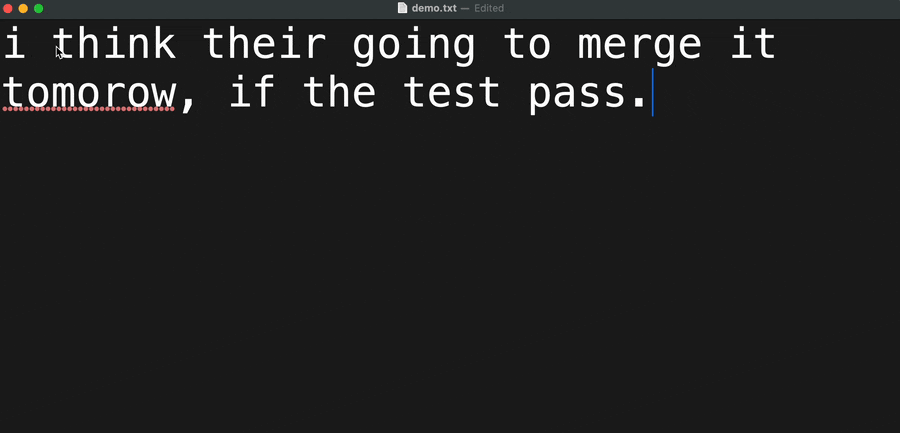

Fix typos and grammar in any macOS app, in place.



Select text, then right-click › Services › Proofread Selection, or press a
shortcut you assign. proofd fixes errors only, and keeps your tone, language,
and Markdown.

It runs through the `claude` or `opencode` CLI you already use, or a local
model, so you need no new account or API key.

## Privacy

proofd sends your selection to the provider you choose, and nowhere else.

- It never touches your clipboard: macOS hands a service the selection
  on a separate pasteboard.
- It has no telemetry, and turns off the CLIs' update checks and
  `claude`'s telemetry.
- It saves nothing. Logs record only the text's length, `claude` keeps no
  session, and proofd deletes the session `opencode` keeps.
- The model gets no tools, so selected text can't make it run commands.
- With a local model, your text never leaves your Mac.

Your provider's policy covers what it receives. The code is about 2,000
lines; start with [`src/providers`](src/providers).

## Install

Requires macOS 14 or later, Xcode Command Line Tools,
[Rust](https://rustup.rs) 1.88 or newer, and `claude`, `opencode`, or a local
model server.

```sh
git clone https://github.com/pisetski/proofd && cd proofd
make install
```

This installs `proofd.app` to `~/Applications` and links the `proofd` command
into `~/.local/bin`.

Then enable **Proofread Selection** in System Settings › Keyboard › Keyboard
Shortcuts › Services › Text, and assign a shortcut your apps don't already
use, like ⌃⇧,.

Always select text first. With nothing selected, some apps, like Firefox,
send the whole field.

## Providers

| Provider        | Your text goes to          | Time per sentence    |
| --------------- | -------------------------- | -------------------- |
| `claude`        | Anthropic                  | 2 s with Haiku       |
| `opencode`      | The provider of your model | 2 s plus the model   |
| `openai-compat` | A server on your Mac       | 13–15 s with Gemma 4 |

Measured on an M1 Pro after the first run, which also loads the model.
Gemma 4 spends most of its time reasoning; a model without reasoning is
faster.

proofd uses `claude` with Haiku by default. If only `opencode` is installed,
it uses DeepSeek V4.1 Flash Free, whose provider keeps no data and doesn't
train on it. To use a local model, start the server in
[LM Studio](https://lmstudio.ai), then create `~/.config/proofd/config.toml`:

```toml
provider = "openai-compat"
base_url = "http://localhost:1234/v1"
model = "google/gemma-4-e4b"
timeout_secs = 25
```

The Services menu gives up after about 30 seconds, so keep `timeout_secs`
below that.

## Configure

Every setting is optional. See
[`config.example.toml`](config.example.toml) for the model, timeout, and
input limit.

To change the prompt, copy `skills/proofread.md` to
`~/.config/proofd/proofread.md` and edit it.

## Terminal

```sh
echo "helo world" | proofd
```

## Why not Apple's Writing Tools?

Writing Tools needs Apple Intelligence, which runs only on Apple silicon and
in supported languages and regions. proofd runs on any Mac with macOS 14, uses
the model you pick, follows a prompt you can edit, and works in the terminal.

## Uninstall

```sh
make uninstall
```

## License

MIT or Apache-2.0.
