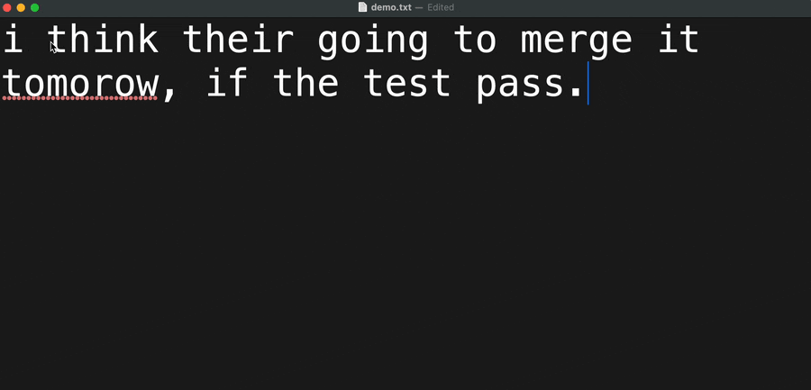

A macOS service that proofreads selected text in place using an LLM CLI.



Select text, then right-click › Services › Proofread Selection.
Or bind it to your own shortcut, like ⌘⌃⌥P.

It fixes errors only, and keeps your tone, language, and Markdown.
Uses your existing `claude` or `opencode` login, so no API key is needed.
Selected text is sent to your configured provider.

## Install

Requires Xcode Command Line Tools, [Rust](https://rustup.rs) 1.75 or newer, and
`claude` or `opencode`.

```sh
git clone https://github.com/pisetski/proofd && cd proofd
make install
```

This installs `proofd.app` to `~/Applications` and links the `proofd` command
into `~/.local/bin`, which must be on your `PATH` to use it from the terminal.

Then enable **Proofread Selection** in System Settings › Keyboard › Keyboard
Shortcuts › Services › Text, and assign your shortcut.

## Terminal

```sh
echo "helo world" | proofd
```

## Configure

Optional. To change the provider (`claude`, `opencode`, or a local
OpenAI-compatible server), model, or timeout:

```sh
mkdir -p ~/.config/proofd
cp config.example.toml ~/.config/proofd/config.toml
```

To change the prompt, copy `skills/proofread.md` to
`~/.config/proofd/proofread.md` and edit it.

## Uninstall

```sh
make uninstall
```

## License

MIT or Apache-2.0.
